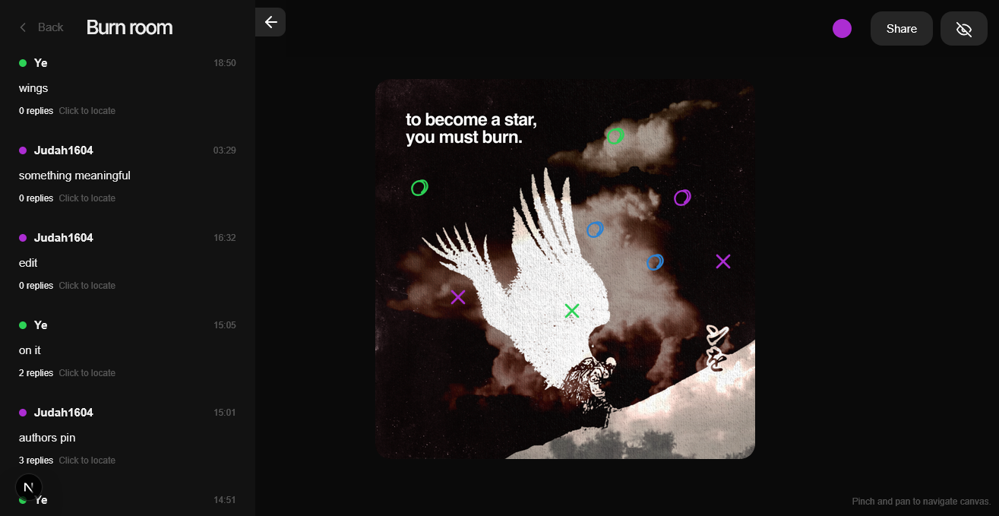

# Notae

**Pin feedback directly on a design, and talk it through in real time.**

Notae is a collaborative design-critique board. Upload a design, invite people into a room, and drop pins on the exact spot you want to discuss. Every pin carries a comment and a reply thread, and everything syncs live between everyone in the room.


<!-- Add a screenshot or demo GIF here. It's the single biggest thing a README can have. -->

<!-- Add the demo video / live link here -->
<!-- **Demo:** https://... -->

## Features

**Rooms and access**
- Email sign-up and login, with a per-user display name and a generated colour
- Create a room by uploading a design (PNG, JPEG or WebP)
- Room membership with a share link, so only members can see a room's design and pins
- Private image storage with short-lived signed URLs

**Canvas**
- Zoom and pan across the design (mouse wheel, drag, and touch pinch)
- Click anywhere to drop a pin
- Pins are stored as 0-1 fractions of the image, so they stay anchored at any zoom level or screen size
- Pin navigator sidebar: a list of every pin, and clicking one zooms to it

**Comments and replies**
- One comment per pin, plus a threaded reply list
- Edit and delete your own comments and replies
- Each author appears in their own colour

**Real time**
- Pins and replies sync instantly across everyone in the room
- Presence: see who is in the room right now, with join and leave notifications

**Usability**
- Responsive layout for desktop and mobile
- Loading, empty and error states

## Tech stack

| Layer | Tool |
|---|---|
| Framework | Next.js 16 (App Router) and React |
| Auth, database, storage, realtime | Supabase (Postgres, Auth, Storage, Realtime) |
| Canvas | [`react-zoom-pan-pinch`](https://github.com/BetterTyped/react-zoom-pan-pinch) |
| Session handling | `@supabase/ssr` (cookie-based sessions) |

## Getting started

### Prerequisites
- Node.js 20 or later
- A free [Supabase](https://supabase.com) project

### 1. Clone and install

```bash
git clone https://github.com/judah1604/notae.git
cd notae
npm install
```

### 2. Environment variables

Create a `.env.local` file in the project root:

```env
NEXT_PUBLIC_SUPABASE_URL=your-project-url
NEXT_PUBLIC_SUPABASE_PUBLISHABLE_KEY=your-publishable-key
```

Both values are in your Supabase dashboard under **Project Settings → API**.

### 3. Set up the database

Run the following in the Supabase SQL editor. Order matters, because policies call the helper function.

**Tables**

| Table | Purpose | Key columns |
|---|---|---|
| `profiles` | One row per user | `id` (= `auth.users.id`), `display_name`, `color` |
| `rooms` | A critique room | `id`, `name`, `created_by`, `image_path`, `image_uploaded_by`, `created_at` |
| `room_members` | Who belongs to which room | `room_id`, `user_id` (composite primary key) |
| `pins` | A pinned comment on the design | `id`, `room_id`, `author_id`, `x`, `y`, `marker_type`, `comment`, `created_at` |
| `replies` | Replies on a pin | `id`, `pin_id`, `author_id`, `text`, `created_at` |

Foreign keys: `room_members.user_id` and `pins.author_id` and `replies.author_id` should reference `profiles.id` so that Supabase can embed profile data in queries. `room_members.room_id`, `pins.room_id` and `replies.pin_id` should reference their parent rows with `ON DELETE CASCADE`.

**Membership helper (prevents recursive RLS)**

```sql
CREATE OR REPLACE FUNCTION public.is_room_member(_room_id uuid)
RETURNS boolean
LANGUAGE sql
STABLE
SECURITY DEFINER
SET search_path = public
AS $$
  SELECT EXISTS (
    SELECT 1 FROM public.room_members
    WHERE room_id = _room_id AND user_id = auth.uid()
  );
$$;

REVOKE EXECUTE ON FUNCTION public.is_room_member(uuid) FROM PUBLIC, anon;
GRANT EXECUTE ON FUNCTION public.is_room_member(uuid) TO authenticated;
```

**Profile creation on sign-up**

```sql
CREATE OR REPLACE FUNCTION public.handle_new_user()
RETURNS trigger
LANGUAGE plpgsql
SECURITY DEFINER
SET search_path = public
AS $$
BEGIN
  INSERT INTO public.profiles (id, display_name, color)
  VALUES (
    NEW.id,
    COALESCE(NEW.raw_user_meta_data->>'display_name', 'User'),
    COALESCE(NEW.raw_user_meta_data->>'color', '#000000')
  )
  ON CONFLICT (id) DO NOTHING;
  RETURN NEW;
END;
$$;

DROP TRIGGER IF EXISTS on_auth_user_created ON auth.users;
CREATE TRIGGER on_auth_user_created
AFTER INSERT ON auth.users
FOR EACH ROW EXECUTE FUNCTION public.handle_new_user();
```

**Row Level Security**

Enable RLS on every table above, then add policies that follow these rules:

| Table | Select | Insert | Update | Delete |
|---|---|---|---|---|
| `rooms` | creator or member | `created_by = auth.uid()` | member | creator |
| `room_members` | members of the same room | yourself, into a room you created or are joining | n/a | yourself |
| `profiles` | yourself and people you share a room with | via the sign-up trigger | yourself | n/a |
| `pins` | room members | member, with `author_id = auth.uid()` | author | author |
| `replies` | members of the pin's room | member, with `author_id = auth.uid()` | author | author |

Use `is_room_member(...)` in the membership checks. A `rooms` SELECT policy for creators (`auth.uid() = created_by`) is also required: inserting with `.select()` runs the SELECT policy on the returned row, and the creator isn't a member yet at that moment.

**Storage**

Create a **private** bucket named `designs`, then add policies on `storage.objects`:

```sql
CREATE POLICY "Members can read room designs"
ON storage.objects FOR SELECT TO authenticated
USING (
  bucket_id = 'designs'
  AND public.is_room_member(((storage.foldername(name))[1])::uuid)
);

CREATE POLICY "Members can upload room designs"
ON storage.objects FOR INSERT TO authenticated
WITH CHECK (
  bucket_id = 'designs'
  AND public.is_room_member(((storage.foldername(name))[1])::uuid)
);
```

Files are stored at `{room_id}/design.{ext}`. Set a per-file size limit and allowed MIME types on the bucket (Free plan projects cap files at 50 MB):

```sql
UPDATE storage.buckets
SET file_size_limit = 15728640,
    allowed_mime_types = ARRAY['image/png', 'image/jpeg', 'image/webp']
WHERE id = 'designs';
```

**Realtime**

Add the tables to the realtime publication:

```sql
ALTER PUBLICATION supabase_realtime ADD TABLE public.pins, public.replies;
```

DELETE events only carry the deleted row's primary key by default, which is all Notae needs.

### 4. Run it

```bash
npm run dev
```

Open [http://localhost:3000](http://localhost:3000).

### Testing with several users

A browser keeps one session at a time. To test collaboration, sign in as the second user in an incognito window or a separate browser profile.

## How it works

- **Normalised pin coordinates.** A pin's position is saved as `x` and `y` between 0 and 1, relative to the image. Pins render inside the zoomable element, so they stay correct at any zoom, pan or screen size.
- **Membership through one function.** Every table and the storage bucket use `is_room_member()`. It runs as `SECURITY DEFINER`, which avoids the infinite recursion that happens when a policy queries its own table.
- **Client-generated pin IDs.** A new pin gets its UUID when it is placed and the same UUID is sent to the database. The optimistic pin, the saved pin and the realtime event all share one identity, so there are no duplicates.
- **Realtime.** Postgres Changes deliver pin and reply inserts, updates and deletes. Supabase Presence tracks who is online in each room.
- **Sessions.** Server actions use the cookie-based `@supabase/ssr` client, and the proxy refreshes the session on each request.

## Project structure

```
src/
  app/
    login/ signup/        # auth pages and server actions
    home/                 # your rooms
    profile/              # profile page
    room/[id]/            # the room (RoomClient: canvas, pins, replies, presence)
    join-room/[id]/       # join flow for people opening a share link
    components/           # PinsSidebar, ShareModal, XMarker, ScribbleMarker
  lib/
    supabase/client.js    # browser client
    supabase/server.js    # server client (cookies)
    color.js              # fixed-saturation, random-hue colour generator
    timeAgo.js
  styles/
proxy.js                  # session refresh
```

## Known limitations

- A room has one design image, and it can't be replaced after creation.
- Comments can't be marked resolved.
- Anyone with a room's share link can join it. There is no per-link expiry or revocation yet.
- Guests need an account. There is no anonymous access.
- Pins use a random X or scribble marker and carry no number.
- Pins can't be moved after placement. Delete and re-place instead.

## Roadmap

Planned for v2, depending on feedback:

- Resolve and reopen comments
- Replace a room's design image
- Redesigned pins: more precise anchors, numbering and reply counts
- Guest access through invite links
- Notifications and an unread indicator
- Export a design with its pins and comments

## Author

Built by Judah. [github.com/judah1604](https://github.com/judah1604)